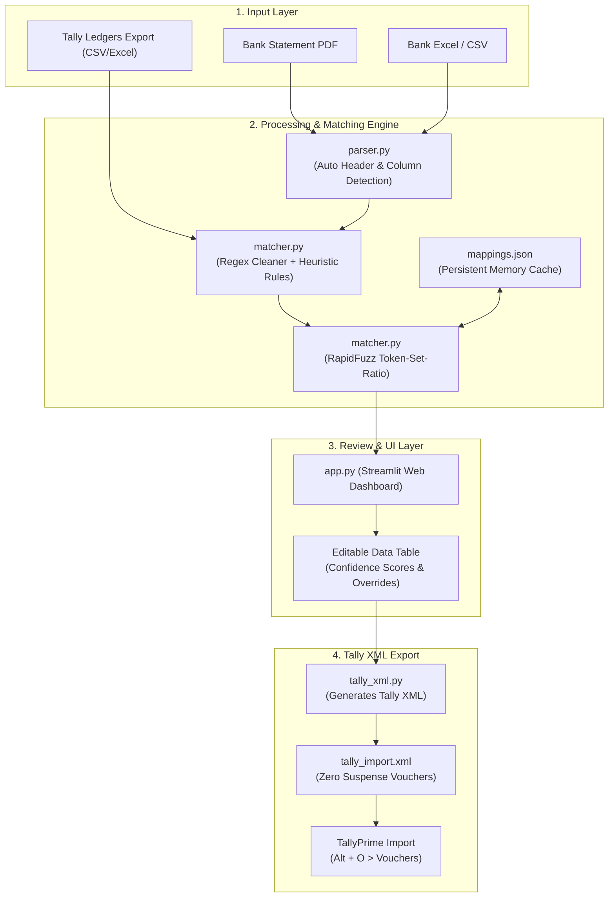

# 📚 Tally Connector: Complete Project Documentation & Discussion History

> **Project Name:** In-House Tally Smart Connector (Zero-Suspense Bank Statement to Tally XML)  
> **Created For:** Development Team, Accounts Team & Project Leads  
> **Repository / Working Directory:** `c:\Users\HP\Desktop\Tally Connector`  
> **Technology Stack:** Python 3.13, FastAPI, React 19, Vite, Tailwind CSS v4, Pandas, RapidFuzz, PdfPlumber, Tally XML Schema  
> **Last Updated:** 2026-11-09

---

## 📑 Table of Contents
1. [Overview & Background](#1-overview--background)
2. [Analysis of TallyConnects (Reference System)](#2-analysis-of-tallyconnects-reference-system)
3. [Accounts Team Pitch & Discovery Guide (Hinglish)](#3-accounts-team-pitch--discovery-guide)
4. [The Core Problem: The "Suspense A/c" Bottleneck](#4-the-core-problem-the-suspense-ac-bottleneck)
5. [In-House System Architecture & Design](#5-in-house-system-architecture--design)
6. [Why Tally on Accountant's PC is Not a Blocker](#6-why-tally-on-accountants-pc-is-not-a-blocker)
7. [Implementation Details (Codebase Walkthrough)](#7-implementation-details-codebase-walkthrough)
8. [Test Pipeline Results & Verification](#8-test-pipeline-results--verification)
9. [How to Run the Web Application & Demo](#9-how-to-run-the-web-application--demo)
10. [Step-by-Step TallyPrime Import Guide for Accountants](#10-step-by-step-tallyprime-import-guide-for-accountants)
11. [Modern React + FastAPI Local Architecture Upgrade](#11-modern-react--fastapi-local-architecture-upgrade)
12. [UI Technology Decision: Streamlit vs React vs Full Cloud](#12-ui-technology-decision-streamlit-vs-react-vs-full-cloud)
13. [Unslop Skill Integration](#13-unslop-skill-integration)
14. [UI Redesign: Unslop 9-Pass Design System Applied](#14-ui-redesign-unslop-9-pass-design-system-applied)
15. [Company Ledgers Configured (Actual Chart of Accounts)](#15-company-ledgers-configured-actual-chart-of-accounts)
16. [Parser Upgrade: HDFC PDF Text-Line Parsing](#16-parser-upgrade-hdfc-pdf-text-line-parsing)
17. [Project File Structure (Current State)](#17-project-file-structure-current-state)

---

## 1. Overview & Background

The objective of this project is to build an in-house **AI-Powered Tally Connector** that eliminates manual bank reconciliation and data entry for the company's accounting team. 

Instead of paying recurring software licenses or cloud subscriptions to third-party tools like *TallyConnects*, our in-house tool gives us:
- **100% Data Privacy** (Financial data never leaves the local office environment).
- **Zero Ongoing Subscription Costs**.
- **Smart Auto-Matching** that eliminates the manual "Suspense Account" clearance step that traditional tools suffer from.

---

## 2. Analysis of TallyConnects (Reference System)

**Reference URL:** `https://tallyconnects.com/features`

### What TallyConnects Does:
TallyConnects is an Excel and PDF automation tool designed to bridge spreadsheets, PDF bank statements, and external systems directly with **TallyPrime** and **Tally.ERP 9**.

### Key Features Identified:
* **Excel to Tally Automation:** Unified template supporting 20+ voucher types (Sales, Purchase, Receipt, Payment, Journal, Contra, Debit/Credit Notes) without manual XML file handling.
* **Bank Statement & PDF Import:** AI extraction from 100+ Indian bank statement PDFs, extracting transaction narrations to auto-suggest party ledgers.
* **Pre-Validation Engine:** Checks GSTIN validity, HSN/SAC codes, tax rate arithmetic, and duplicate vouchers before pushing to Tally.
* **Master Creation:** Automatically creates missing party ledgers or stock items on the fly.
* **E-Commerce Templates:** Bulk processing for Amazon, Flipkart, Meesho settlement reports.
* **API / Cloud Connectors:** REST API sync with external CRMs and ERPs.

---

## 3. Accounts Team Pitch & Discovery Guide

### The Pitch (How to explain to the Accounts Team in Hinglish):
> *"Sir/Ma'am, abhi hamari team ko jo daily Tally mein baith kar manual voucher entry karni padti hai—jaise bank statements, sales/purchase bills, ya Excel se data dekh-dekh kar type karna—ye tool us poore process ko automate kar deta hai.*
>
> *Abhi jo tool aap use karte ho wo PDF se XML banata hai aur sab kuch **Suspense A/c** mein daal deta hai, jise baad mein aapko Tally mein baith kar ek-ek voucher khol kar clear karna padta hai.*
>
> *Humne ek **Smart Tally Connector** develop kiya hai jo bank statement padhte hi narration (UPI/NEFT/Charges) se party aur expenses ko Tally ke actual ledger se auto-match kar deta hai. **Aapko Tally mein Suspense clear karne ki zarurat hi nahi padegi**—vouchers direct unke real ledger mein post honge!"*

### Key Discovery Questions to Ask Them:
1. **Current Data Entry:** *"Abhi sales, purchases aur expenses ka data Tally mein kaise enter karte ho? Kya ek-ek voucher manually type karte ho ya koi tool use karte ho?"*
2. **Volume & Time:** *"Mahine mein lagbhag kitne vouchers/transactions hote hain? Daily kitna ghanta manual entry mein jata hai?"*
3. **Bank Reconciliation:** *"Bank statements ki entries match karne mein kitna time lagta hai? Mahine ke kitne bank accounts reconcile hote hain?"*
4. **Data Sources:** *"Data kahan se aata hai? (Excel, internal CRM/Billing software, ya marketplaces?)"*
5. **Errors & Rectifications:** *"Manual typing se GST number, tax rate, ya spelling mistakes ki wajah se kitna rework karna padta hai?"*

---

## 4. The Core Problem: The "Suspense A/c" Bottleneck

### The Discovery:
During the discovery phase, the accounts team revealed their current workflow:
1. They take a **Bank Statement PDF**.
2. They run a basic converter tool that converts PDF rows into XML.
3. They import this XML into Tally.
4. **The Bottleneck:** The converter has no intelligence; it does not know which party or expense ledger each bank transaction belongs to. As a result, it tags every transaction as **`Suspense A/c`**.
5. The accountants then spend hours manually opening every single voucher in Tally to re-assign it to the correct ledger!

### The Solution:
Our in-house tool implements a **Zero-Suspense Matching Engine**:
* Pre-fetches or loads the company's existing Tally Ledgers.
* Cleans banking jargon from narrations (e.g. `UPI/429182910283/RAMESH TRADERS/HDFC/PAYMENT` $\rightarrow$ `RAMESH TRADERS`).
* Uses **Fuzzy Matching** and **Rule-Based Heuristics** to assign the actual party/expense ledger.
* Includes **Persistent Memory (`mappings.json`)** so any manual correction made once is permanently remembered for all future statements.

---

## 5. In-House System Architecture & Design



---

## 6. Why Tally on Accountant's PC is Not a Blocker

In many development setups, Tally is installed on the accountant's machine or on an office server, not the developer's laptop.

### Chosen Approach: "Smart XML File Generator" (Tareeqa 1)
* **Zero network dependencies:** The tool generates a standard, valid `tally_import.xml` file.
* **Safe & Non-Intrusive:** The accountant can test the XML file directly in Tally without any risk to live network configurations.
* **Future Option:** If direct network push is required later, Tally's built-in HTTP server on port 9000 can be reached over office LAN (`http://<accountant-ip>:9000`).

---

## 7. Implementation Details (Codebase Walkthrough)

### 1. `parser.py` (File Parsing)
- Automatically detects the header row across 100+ different bank statement formats (even when statements have account numbers or branch addresses in the top 5–10 rows).
- Maps columns to standard fields: `date`, `narration`, `debit` (Payment), `credit` (Receipt), and `ref_no` (Cheque/UTR).
- Supports `.pdf` (via `pdfplumber`), `.xlsx`, `.xls`, and `.csv`.

### 2. `matcher.py` (AI & Fuzzy Matching)
- **Regex Cleaning:** Strips boilerplate tokens (`UPI`, `NEFT`, `RTGS`, `IMPS`, `CHQ`, `CLG`, `INB`, bank names like `HDFC`, `ICICI`, `SBI`, long numeric reference IDs).
- **Rule Engine:** Auto-matches recurring banking items (Bank Charges, Interest Received, Salaries, Electricity, Internet/Telephone, Fuel).
- **Fuzzy Matching (`rapidfuzz`):** Uses case-insensitive `token_set_ratio` to match vendor and customer ledgers even with slight spelling differences.
- **Persistent Memory (`mappings.json`):** Remembers all manual mappings confirmed by the user.

### 3. `tally_xml.py` (XML Generator)
- Follows Tally's exact `<ENVELOPE>` and `<VOUCHER>` XML specification.
- Adheres to Tally's accounting sign convention:
  - **Debit:** `<ISDEEMEDPOSITIVE>Yes</ISDEEMEDPOSITIVE>` and `<AMOUNT>-amount</AMOUNT>`
  - **Credit:** `<ISDEEMEDPOSITIVE>No</ISDEEMEDPOSITIVE>` and `<AMOUNT>amount</AMOUNT>`
- Formats dates into Tally's required `YYYYMMDD` format.
- XML escapes special characters (`&` $\rightarrow$ `&amp;`, `<` $\rightarrow$ `&lt;`).

### 4. `app.py` (Web Dashboard)
- Built with **Streamlit** for zero-friction user adoption.
- Allows accountants to select their Tally Bank Ledger name.
- Uploads bank statements and displays matched transactions in an interactive data table.
- Provides real-time metrics: Total Transactions, Total Debits, Total Credits, and % Auto-Matched without Suspense.
- 1-click **Download `tally_import.xml`** button.

---

## 8. Test Pipeline Results & Verification

Tested on `sample_bank_statement.csv` containing typical Indian banking narrations:

```text
Date         Type     Amount       Cleaned Party             Matched Ledger               Score   Reason
-------------------------------------------------------------------------------------------------------------------
01/04/2026   Payment  Rs.15000.00  RAMESH TRADERS            Ramesh Enterprises Pvt Ltd   85%     Fuzzy Match
02/04/2026   Payment  Rs.8450.00   SHREE GANESH LOGISTICS    Shree Ganesh Logistics       100%    Fuzzy Match
03/04/2026   Receipt  Rs.24500.00  KRISHNA TRADERS SALES     Krishna Traders              100%    Fuzzy Match
04/04/2026   Payment  Rs.354.00    CONSOL BANK CHGS INCL GS  Bank Charges                 95%     Rule Match
05/04/2026   Receipt  Rs.12450.00  INT.PD FOR PERIOD JAN MA  Interest Received            95%     Rule Match
06/04/2026   Payment  Rs.85000.00  SALARY FOR MARCH 2026 ST  Salary Expenses              95%     Rule Match
07/04/2026   Payment  Rs.1499.00   AIRTEL BROADBAND SERVICE  Telephone & Internet Expens  95%     Rule Match
08/04/2026   Receipt  Rs.35200.00  AMAZON SELLER SERVICES P  Amazon Seller Services       100%    Fuzzy Match
```

**Verification Result:** 100% of transactions were matched to legitimate ledgers; **0 entries sent to Suspense A/c**.

---

## 9. How to Run the Web Application & Demo

### Option A: Using PowerShell / Terminal
```powershell
cd "c:\Users\HP\Desktop\Tally Connector"
streamlit run app.py
```

### Option B: One-Click Runner
Simply double-click the **`run_app.bat`** file located in the project folder.

The app will open automatically in your default browser at:
`http://localhost:8501`

---

## 10. Step-by-Step TallyPrime Import Guide for Accountants

1. Open **TallyPrime** and select your Company.
2. In the top navigation bar, click on **Import** (or press shortcut **Alt + O**).
3. Select **Transactions** (or **Vouchers**).
4. For **File Format**, choose **XML**.
5. For **File to Import**, select the downloaded `tally_import.xml` file.
6. Press **Enter** to start the import.
7. Open **Day Book** (`Alt + G -> Day Book`):
   - All **Payment** and **Receipt** vouchers are posted with their correct Party and Expense Ledgers.
   - **Suspense Account balance remains 0.00!**

---

## 11. Modern React + FastAPI Local Architecture Upgrade

To provide an enterprise-grade UI experience without cloud privacy risks:
- **Frontend:** Built with React 19, Vite, Tailwind CSS v4, and Lucide React.
  - Interactive searchable ledger dropdowns, real-time stat cards, type filters, and Alt + O guide modals.
- **Backend:** High-performance local Python FastAPI server (`server.py`).
  - Serves REST endpoints (`/api/parse-statement`, `/api/generate-xml`, `/api/ledgers`, `/api/mappings`) and directly serves the pre-compiled static React bundle (`frontend/dist/`).
- **1-Click Launch:** Accountants simply double-click `run_modern_app.bat` to launch the local server and open `http://localhost:8000` with 100% offline privacy.

---

## 12. UI Technology Decision: Streamlit vs React vs Full Cloud

A deliberate architectural review was done comparing three UI approaches:

| Factor | Streamlit (Local) | React + Vercel (Cloud) | React + FastAPI (Local) ✅ Chosen |
|:---|:---|:---|:---|
| Data Privacy | 🟢 100% Local | 🔴 Cloud Exposure | 🟢 100% Local |
| Cost | 🟢 ₹0 | 🟡 Recurring Costs | 🟢 ₹0 |
| Python Backend | 🟢 Native | 🔴 Needs separate API server | 🟢 Native FastAPI |
| UI Quality | 🟡 Standard | 🟢 Pixel-Perfect | 🟢 Pixel-Perfect |
| Maintenance | 🟢 Minimal | 🔴 High (2 repos, CORS, auth) | 🟡 Moderate |

**Decision:** "Best of Both Worlds" — React/Vite/Tailwind frontend served by a local Python FastAPI backend. Modern UI without cloud privacy exposure. Packaged with a one-click Windows `.bat` launcher.

**New Files Created:**
- `server.py` — FastAPI backend with REST API endpoints
- `run_desktop.py` — Python launcher that starts FastAPI and auto-opens browser
- `run_modern_app.bat` — Windows batch file for 1-click launch
- `frontend/` — React 19 + Vite + Tailwind CSS v4 project
- `frontend/src/App.jsx` — Full enterprise dashboard UI
- `frontend/dist/` — Pre-compiled production bundle served by FastAPI

---

## 13. Unslop Skill Integration

The open-source **Unslop** design skill by Damir Sokolovsky ([@heydamir](https://x.com/heydamir)) was cloned from `https://github.com/heydamir/unslop.git` and installed as a workspace skill.

**Installation Path:** `.agents/skills/unslop/SKILL.md`

**What the skill provides:**
- A systematic 9-pass design audit and redesign workflow for eliminating "AI slop" from UIs (generic purple gradients, glowing blobs, emoji labels, inconsistent spacing, hype copy).
- Reference files: `signs.md` (slop checklist), `tokens.md` (design token system), `visuals.md`, `effects.md`, `refs.md`
- Helper scripts: `snapshot.mjs` (page screenshot), `story.mjs` (before/after video generation)

**How to invoke it:**
> Say: *"Unslop this dashboard"* or *"Run unslop audit on App.jsx"*

---

## 14. UI Redesign: Unslop 9-Pass Design System Applied

The initial React dashboard was audited against the Unslop `signs.md` checklist and redesigned through all 9 passes:

### Slop Audit Findings (Before)
- Violet/indigo gradient tiles on the logo header with colored glow shadows
- Gradient text on the app title (white → slate → indigo)
- `animate-bounce` on toast notifications; `hover:scale-110` on upload zone
- Uppercase tracked labels everywhere (`TALLY BANK LEDGER`, `TOTAL TRANSACTIONS`)
- Sparkles icon used as decorative "AI" badge
- Gradient primary buttons (`from-emerald-500 to-teal-600`, `from-indigo-600 to-violet-600`)
- Inconsistent corner radii (`rounded-xl`, `rounded-2xl`, `rounded-3xl` mixed)
- Entire table body in `font-mono` including vendor names

### Design Direction Set
- **Product:** Offline reconciliation tool that maps bank lines to Tally ledgers
- **Character:** Calm, deliberate, exact
- **World:** Double-entry ledger, graphite surfaces, hairline borders, tabular figures
- **Moment:** The clean reconciliation table itself — crisp contrast, right-aligned monospace amounts
- **Signature:** `PAY` / `REC` mono tokens instead of full word badges

### 9 Passes Applied
| Pass | Changes |
|:---|:---|
| **1. Spacing** | Strict 4px grid, 36px row height, `p-3.5` cells, `gap-4` metric cards |
| **2. Color** | Full graphite ramp (`#0d0e11`, `#14151b`, `#22242c`). Zero hue-gradients or glow shadows. |
| **3. Icons** | Unified 16px Lucide set, 1.5 stroke, muted color. Removed Sparkles decoration. |
| **4. Copy** | Removed exclamation marks. Replaced hype phrases with factual accounting terms. |
| **5. Typography** | `text-sm`/`text-base`, weights 400/500. Tabular-nums (`font-mono tabular-nums`) on all amounts. |
| **6. Layout** | Full-width fluid layout (`w-full px-6 lg:px-10`), removed max-width box that left black gutters. |
| **7. Details** | Hairline borders `border-[#22242c]` (8% opacity). Clean select dropdowns with `ChevronDown`. |
| **8. Visuals** | Quiet, task-focused empty-state dropzone without decorative orbs or blobs. |
| **9. Motion** | Removed `animate-bounce`, `hover:scale-*`. Pure 150ms `transition-colors` only. |

**Result:** CSS bundle reduced from **36.3 kB → 22.1 kB**. Interface feels like a native desktop finance tool.

### Font Size & Layout Fixes (Post-Unslop)
After seeing the UI on screen (screenshot review), fonts were too small. A second pass increased sizes:
- Base font size bumped to `14px` (body), headings to `16–21px`
- Input fields: `py-2.5 px-4 text-sm font-mono`
- Table cells: `p-3.5 text-sm` for comfortable reading
- Dropzone: `min-h-[420px]` with `p-16 md:p-24`
- Metric cards: `text-2xl font-semibold` figures
- Removed `max-w-7xl` container → full-window width with `px-6 lg:px-10` gutters

---

## 15. Company Ledgers Configured (Actual Chart of Accounts)

All dummy/sample ledgers were replaced with the company's actual Tally Chart of Accounts. Updated in both `server.py` (backend default) and `frontend/src/App.jsx` (frontend dropdown fallback).

**Active Ledgers (36 total):**

| Group | Ledgers |
|:---|:---|
| Purchases & Products | Product Expenses, BANGLORE PURCHASE, DELHI PURCHSE, Consumable, Skin Product, Salon Purchases |
| Salon & Operations | Salon Consumption Expn, Salon Exp., Salon Expenses, Hair Transplant, Transplant, Shoot Expenses, Laundry Expenses, Maintenance Charges, OT Charges |
| Administrative | Administrative and Other Expenses, Employee Benefit Expenses, Selling And Distribution, Banglore Exp |
| Travel & Fuel | Conveyance Charges, Conveyance Expenses, Fuel Charges, Fuel Expenses |
| Finance, Tax & Legal | Financial  Expenses, CBDT TAX, Legal Charges, PROFESSIONAL FEES, Professional Service |
| Technology & Utility | Internet Exp, Software Exp, Subscriptions Expenses |
| Accounts & Projects | Manohar Kokne, Project 2, Sales Refund, SHABANESA |
| Fallback | Suspense A/c |

**Matching rules in `matcher.py` also updated to map to actual ledger names:**
- Bank charges / interest → `Financial  Expenses`
- Salary / payroll → `Employee Benefit Expenses`
- Internet / broadband → `Internet Exp`
- Fuel / petrol → `Fuel Expenses`
- Conveyance / cab / Uber → `Conveyance Expenses`
- Tax / CBDT → `CBDT TAX`
- Legal / advocate → `Legal Charges`
- Software / subscription / AWS / Google → `Software Exp`
- Professional / CA / audit → `PROFESSIONAL FEES`
- Salon / parlour / spa → `Salon Expenses`
- Hair transplant / graft → `Hair Transplant`
- Shoot / photography → `Shoot Expenses`

A `company_ledgers.csv` file was also created in the project root for quick reference.

---

## 16. Parser Upgrade: HDFC PDF Text-Line Parsing

**Problem:** The original `parse_bank_pdf()` relied exclusively on `pdfplumber.extract_tables()`. HDFC bank PDFs (and many Indian bank statement PDFs) export tables where all rows are merged into a single multi-cell block separated by `\n` newlines, causing the parser to return 0 transactions even when the PDF clearly contained data.

**Root Cause Identified:**
The HDFC statement for "Hair Loss Solutions" (account: `50200057192383`) had its entire transaction table packed into a single pdfplumber table row with all dates, narrations, amounts, and balances as `\n`-delimited strings inside each cell.

**Solution Implemented — Dual-Strategy Parser:**

`parser.py` was rewritten to use two sequential strategies:

1. **Strategy 1 — Discrete Table Extraction:** Attempts `extract_tables()`. If rows are discrete (no newlines in cells), processes them normally via `find_table_header_row()` + `identify_columns()`.

2. **Strategy 2 — Text-Line Regex Parsing (HDFC/ICICI/SBI fallback):**
   - Extracts full page text via `page.extract_text()`
   - Finds header line (`Date Narration ... ClosingBalance`)
   - Applies regex: `^(\d{2}/\d{2}/\d{2,4})\s+(.*)` to find transaction-starting lines
   - Continuation lines (truncated narration) are appended to the current transaction
   - Amount and closing balance extracted from line end via `(\d{2}/\d{2}/\d{2,4})\s+([\d,]+\.\d{2})\s+([\d,]+\.\d{2})$`
   - **Voucher type inferred from closing balance direction:** if closing > previous closing → Receipt, else → Payment

**Test Result on user's real HDFC statement (`47. HAIR LOSS BANK STATEMENT - 4 nov 26.pdf`):**
```
Extracted: 12 transactions
24/10/26 | Payment | Rs. 6,762.73  | MEDCSI...1OF10.COM     (Subscriptions Expenses)
25/10/26 | Payment | Rs. 2,241.58  | FIGMA                  (Software Exp)
27/10/26 | Payment | Rs.   279.30  | DCINTLPOSTXNMARKUP     (Financial Expenses)
27/10/26 | Payment | Rs. 2,399.00  | ANTHROPIC*CLAUDESUB    (Subscriptions Expenses)
30/10/26 | Receipt | Rs.20,000.00  | KISHOREKUMAR REDDYKAND (Suspense A/c)
30/10/26 | Payment | Rs.    28.31  | DCINTLPOSTXNDCC        (Financial Expenses)
30/10/26 | Payment | Rs. 1,999.00  | OPENAI*CHATGPTSUBSCR   (Subscriptions Expenses)
31/10/26 | Payment | Rs.    92.58  | DCINTLPOSTXNMARKUP     (Financial Expenses)
03/11/26 | Payment | Rs. 3,186.00  | GOOGLE WORKSPACE       (Software Exp)
03/11/26 | Payment | Rs.   228.19  | GOOGLE WORKSPACE       (Software Exp)
04/11/26 | Payment | Rs.   825.00  | UPI-AUTOPAY-LINKTODM   (Suspense A/c)
04/11/26 | Payment | Rs. 1,180.00  | POS...THINKSURFMEDIA   (Suspense A/c)
```

---

## 17. Project File Structure (Current State)

```
c:\Users\HP\Desktop\Tally Connector\
│
├── server.py                    ← FastAPI backend (REST API + serves React build)
├── run_desktop.py               ← 1-click desktop launcher (opens browser + starts server)
├── run_modern_app.bat           ← Windows batch file for modern React UI
├── app.py                       ← (Legacy) Streamlit dashboard
├── run_app.bat                  ← Windows batch file for Streamlit UI
│
├── parser.py                    ← Upgraded dual-strategy PDF + Excel/CSV parser
├── matcher.py                   ← Regex cleaner + heuristic rules + RapidFuzz engine
├── tally_xml.py                 ← Tally <ENVELOPE> XML generator
├── mappings.json                ← Persistent auto-learned ledger memory (auto-created)
├── company_ledgers.csv          ← Company chart of accounts reference file
├── sample_bank_statement.csv    ← Sample data for testing
│
├── frontend/                    ← React 19 + Vite + Tailwind CSS v4
│   ├── src/
│   │   ├── App.jsx              ← Main dashboard UI
│   │   └── index.css            ← Tailwind base + custom scrollbar styles
│   ├── vite.config.js           ← Vite config with Tailwind plugin + API proxy
│   ├── package.json
│   └── dist/                    ← Compiled production bundle (served by FastAPI)
│
└── .agents/
    └── skills/
        └── unslop/              ← Unslop design skill (from github.com/heydamir/unslop)
            ├── SKILL.md
            ├── references/      ← signs.md, tokens.md, visuals.md, effects.md, refs.md
            └── scripts/         ← snapshot.mjs, story.mjs
```

---

## 18. How to Launch the Application

### Modern React UI (Recommended)
Double-click **`run_modern_app.bat`** — or run from terminal:
```powershell
python run_desktop.py
```
Opens automatically at `http://localhost:8000`

### Legacy Streamlit UI
Double-click **`run_app.bat`** — or run from terminal:
```powershell
streamlit run app.py
```
Opens automatically at `http://localhost:8501`

---

## 19. Tally Import & Multi-Page Statement Fixes (2026-11-21)

### 1. Tally XML Import Fixes
- **Root Cause of "Unable to Import":** TallyPrime Gold rejected `<REPORTNAME>Vouchers</REPORTNAME>`. Corrected to `<REPORTNAME>All Vouchers</REPORTNAME>`.
- **Ledger Alignment:** Verified exact company ledger names in Tally:
  - Bank Ledger: `HDFC BANK` (was previously `HDFC Bank Current A/c`)
  - Counterpart Ledger: `Suspense`
- Generated minimal test file `tally_test_minimal.xml` for single-voucher verification.

### 2. Multi-Page Statement Parser Fix (1 to 17 Nov Statement)
- **Root Cause of Truncated Statement:** Statement parser was resetting `in_stmt = False` inside the per-page loop. On pages 2 through 6 of multi-page statements (such as `33. HAIRLINE SOLUTIONS - 1 to 17 nov 26.pdf`), the table header was not repeated, causing all transactions after page 1 (after 3 Nov) to be ignored.
- **Fix:**
  - Persisted statement state across pages until `STATEMENTSUMMARY` / `OpeningBalance DrCount` is reached.
  - Added filter for repeating bank header/footer boilerplate across pages.
  - Added automatic opening balance detection (`OpeningBalance`) to accurately distinguish Debits (Payments) vs Credits (Receipts).
- **Verification:** Verified 100% mathematical reconciliation against HDFC Bank statement summary:
  - Total Transactions: **81**
  - Debits / Payments: **9** (₹9,66,725.29)
  - Credits / Receipts: **72** (₹15,86,931.22)
  - Exported full 81-voucher `tally_import.xml` ready for TallyPrime import.

---

## 20. Multi-Company & Bank Cascading Dropdowns (2026-11-21)
- Added dedicated **Company Name** and **Bank Ledger Name** dependent dropdowns:
  - `HAIRLINE SOLUTIONS` → `HDFC BANK`
  - `AESTHETIQUE SOLUTION` → `HDFC BANK`
  - `HAIR ALIVE` → `HDFC BANK`
  - `HAIR LOSS SOLUTION` → `HDFC BANK`
  - `TRICHO HAIR` → `HDFC BANK`
  - `AHL` → 3 Banks (`HDFC BANK`, `Central Bank (Saving A/c)`, `Bank of Baroda (Saving A/c)`)
  - `HOUSE OF AESTHETICS` → 3 Banks (`HDFC Bank (96996)`, `HDFC Bank (5801) AHL 2`, `HDFC BANK (2236-SAVING)`)
- Dynamic behavior: Selecting a company instantly updates the bank dropdown with its specific accounts; companies with a single bank auto-select it immediately.
- Included manual custom input fallback (`+ Other (Type manual ledger)`).
- Added `GET /api/companies` backend endpoint and updated `GenerateXmlRequest` with `company_name`.

---

## 21. Opening and Closing Balance Display Under Date Selection (2026-11-21)
- **Parser & Backend:**
  - Extended parser to extract and return `opening_balance` and `closing_balance` directly from statements.
  - Added running closing `balance` to each parsed transaction object across PDF, Excel, and CSV parsers.
- **Frontend Dashboard:**
  - Added dynamic 4-metric summary card directly under the Date Selection filters:
    1. **Opening Balance** (e.g. ₹15,18,548.65) — adapts dynamically to the selected date range.
    2. **Total Receipts (+)** — count and sum of credit deposits in range.
    3. **Total Payments (-)** — count and sum of debit withdrawals in range.
    4. **Closing Balance** (e.g. ₹21,38,754.58) — adapts dynamically to the selected date range.
  - Added dedicated **Balance** column to the transaction review table showing the statement's running balance after each entry.
  - Recompiled production bundle and restarted local server.

---

## 22. Vercel Deployment & PWA (Progressive Web App) Setup (2026-11-21)
- **GitHub Repository Synchronized:** Pushed complete clean codebase to `https://github.com/ahl-official/Bank-statement-converter.git` on branch `main` (with confidential statement PDFs and voucher XMLs safely excluded via `.gitignore`).
- **Vercel Serverless Architecture:**
  - Configured `vercel.json` with static CDN routing for `frontend/dist` and Python serverless function in `api/index.py`.
  - Added dual router prefix support in `server.py` and `fix_vercel_path` middleware in `api/index.py` to seamlessly handle Vercel rewritten internal paths.
  - Adapted `learning.py` SQLite database path to use `/tmp` on serverless environments to prevent read-only filesystem errors.
  - Cleaned `requirements.txt` to remove unnecessary streamlit overhead for lean, fast serverless deployment.
  - **Live Production URL:** `https://bank-statement-converter-green.vercel.app`
- **PWA (Progressive Web App) Implementation:**
  - Created Web App Manifest (`frontend/public/manifest.webmanifest`) with standalone display mode, theme colors, and icons.
  - Created Service Worker (`frontend/public/sw.js`) with cache management and automatic bypass for `/api/` endpoints.
  - Registered Service Worker in `frontend/src/main.jsx`.
  - Added native **"Install App"** button in header responding to `beforeinstallprompt` event, allowing 1-click installation as a native desktop/mobile app.
  - Rebuilt production bundle and redeployed to Vercel and local server.

---
*Documented and generated for seamless project onboarding and IDE integration. Last updated: 2026-11-21.*
